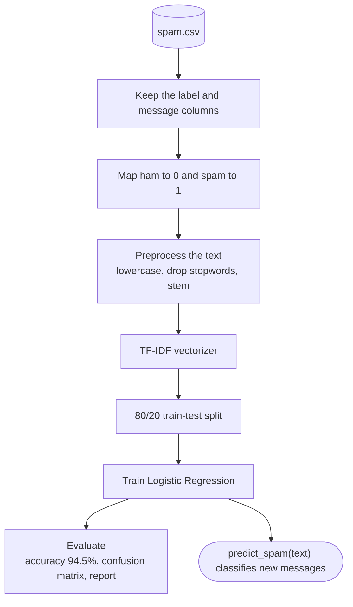

# 🚀 SMS Spam Detection

Classify text messages as spam or legitimate (ham) using TF-IDF features and Logistic Regression.

## 📌 Overview

Using the SMS Spam Collection dataset (5,572 messages), this notebook cleans the text, converts it to TF-IDF vectors, and trains a Logistic Regression classifier to flag spam.

## ✨ Features

* Text preprocessing: lowercasing, stopword removal, Porter stemming
* TF-IDF vectorization (4,900-word vocabulary)
* 80/20 train-test split with evaluation by accuracy, confusion matrix, and classification report
* A `predict_spam(text)` helper for trying your own messages

## 🔄 Workflow

The notebook pipeline, from raw messages to a spam classifier.



## 🛠️ Tech Stack

* Language: Python
* Libraries: Pandas, NLTK, Scikit-learn
* Tools: Git, GitHub, Jupyter Notebook

## 📂 Project Structure

```
spam-detection-project/
├── SMSspamcollectionproject.ipynb   # full pipeline
├── spam.csv                         # dataset
├── requirements.txt
└── LICENSE
```

## ⚙️ Installation

1. Clone the repository:

```
git clone https://github.com/JAIMINRSOJITRA/spam-detection-project.git
```

2. Navigate to the project:

```
cd spam-detection-project
```

3. Install dependencies:

```
pip install -r requirements.txt
```

## ▶️ Usage

Open the notebook and run all cells:

```
jupyter notebook SMSspamcollectionproject.ipynb
```

## 📊 Results / Demo

* **94.5% accuracy** on the held-out test set (measured by running the full pipeline on the included dataset).

## 🧠 What I Learned

* Cleaning and normalizing text for machine learning
* How TF-IDF turns text into features
* Reading a confusion matrix, not just accuracy, for an imbalanced problem

## 🔮 Future Improvements

* Compare against Naive Bayes and SVM
* Keep numbers and symbols as features, since spam often relies on them
* Wrap the model in a small web app

## 🤝 Contributing

Contributions, issues, and suggestions are welcome.

## 📄 License

This project is licensed under the MIT License.

## 👨‍💻 Author

Jaimin Sojitra

* GitHub: https://github.com/JAIMINRSOJITRA
* LinkedIn: https://www.linkedin.com/in/jaimin-sojitra-4683a1277/
